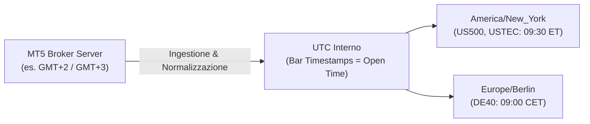
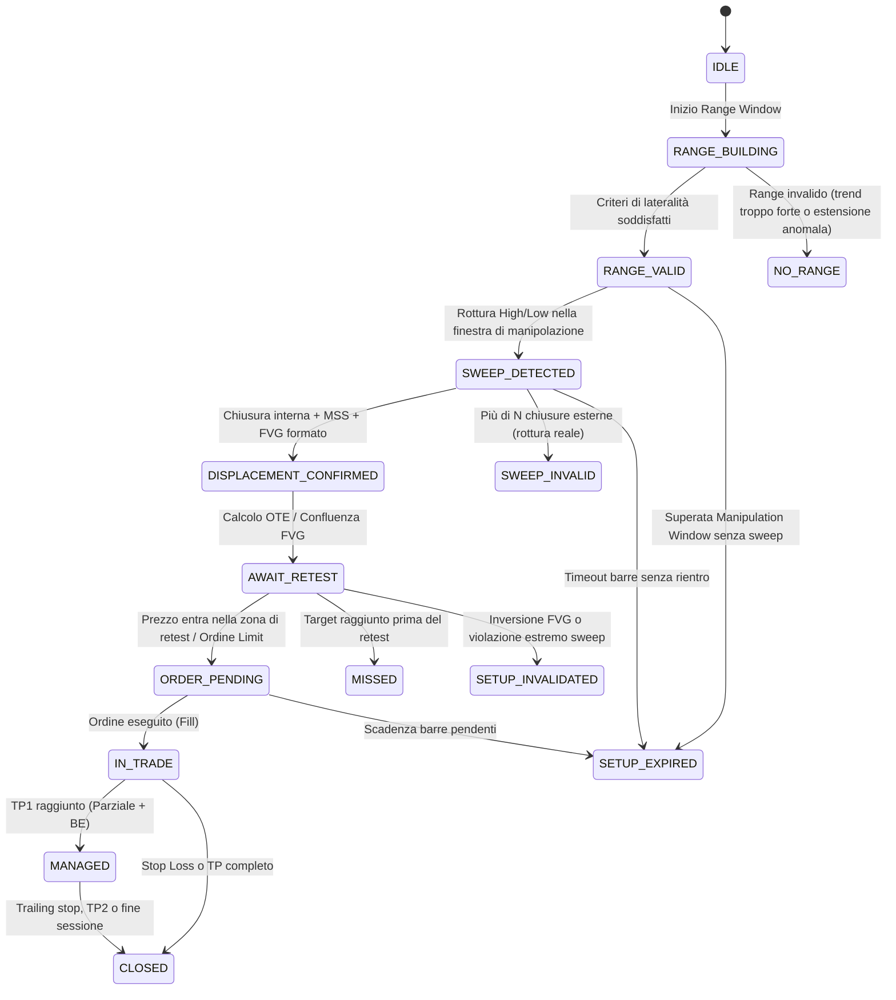

# 📘 STRATEGY SPECIFICATION: WAM-FVG (v1.0-draft)
**Wyckoff Accumulation–Manipulation–Distribution + Fair Value Gap Intraday Index Strategy**

---

## 1. Visione e Obiettivo
La strategia **WAM-FVG** è un sistema di trading quantitativo intraday progettato specificamente per CFD su indici azionari:
- **S&P 500** (`US500` / `SPX500`)
- **Nasdaq 100** (`USTEC` / `NAS100`)
- **DAX 40** (`DE40` / `GER40`)

L'obiettivo è formalizzare e automatizzare una metodologia discrezionale consolidata nell'analisi strutturale dei mercati (Wyckoff Schematics & ICT Liquidity Sweeps), trasformando concetti soggettivi (falsa rottura, rientro impulsivo, squilibrio domanda/offerta) in regole matematicamente deterministiche, testabili barra per barra ed esenti da look-ahead bias.

---

## 2. Glossario e Mappatura Concettuale

| Concetto Utente | Teoria di Wyckoff | ICT / SMC | Entità Codice (`src/strategies/wam_fvg/`) |
| :--- | :--- | :--- | :--- |
| **Lateralizzazione pre-apertura** | Fase A-B (Trading Range) | Session Consolidation / Asian-London Range | `SessionRange` |
| **Falsa rottura di max/min** | Spring (sotto) / Upthrust-UTAD (sopra) (Fase C) | Liquidity Sweep / Judas Swing | `LiquiditySweep` |
| **Rientro forte e veloce** | SOS (Sign of Strength) / SOW (Sign of Weakness) | Displacement + Market Structure Shift (MSS) | `Displacement`, `StructureShift` |
| **Imbalance di prezzo** | Squilibrio tra compratori e venditori | Fair Value Gap (FVG a 3 candele) | `FairValueGap` |
| **Retest dell'imbalance** | LPS (Last Point of Support) / LPSY (Supply) | Retest FVG / OTE (Optimal Trade Entry) | `RetestEntry` |
| **Target liquidità opposta** | Estremo opposto della bilancia di Wyckoff | Buy-Side (BSL) / Sell-Side Liquidity (SSL) | `LiquidityTarget` |

---

## 3. Gestione Fusi Orari e Sessioni (Timezone-Aware)
Il sistema gestisce i fusi orari tramite `zoneinfo.ZoneInfo`, convertendo ogni dato in UTC per l'elaborazione interna:

### Disallineamento Ora Legale (DST Mismatch)
> [!IMPORTANT]
> Gli Stati Uniti e l'Unione Europea cambiano ora legale in settimane differenti (marzo e ottobre/novembre). Durante queste finestre (es. fine ottobre 2026), l'apertura del NYSE (09:30 ET) non coincide con le 15:30 italiane, ma con le **14:30**. 
> Il codice aggancia rigorosamente le finestre al fuso locale dello strumento, prevenendo errori di orario.

### Template di Sessione Iniziali:
1. `us_open` (US500, USTEC, opzionale DE40):
   - Fuso: `America/New_York`
   - Range Window: `06:30` - `09:30` ET
   - Manipulation Window: `09:30` - `11:00` ET
   - Entry Deadline: `11:30` ET
2. `frankfurt_open` (DE40):
   - Fuso: `Europe/Berlin`
   - Range Window: `07:00` - `09:00` CET
   - Manipulation Window: `09:00` - `10:30` CET
   - Entry Deadline: `11:00` CET

---

## 4. Macchina a Stati Finita (FSM)

Per ciascun asset e sessione attiva, la strategia esegue la seguente FSM deterministica a candela chiusa:

---

## 5. Specifiche Algoritmiche e Regole Matematiche

### 5.1 Definizione e Validazione del Range (Accumulazione)
Il range è definito sui massimi e minimi degli estremi delle candele (wick) della finestra su timeframe primario (M15 / M5):
- $Range_{High} = \max(High_t), \quad Range_{Low} = \min(Low_t)$ per $t \in [T_{start}, T_{end}]$
- $Range_{Height} = Range_{High} - Range_{Low}$
- **Criterio Altezza Volatilità**:
  $$\text{min\_height\_atr} \times ATR_{14} \le Range_{Height} \le \text{max\_height\_atr} \times ATR_{14}$$
- **Filtro di Non-Tendenza (Kaufman Efficiency Ratio)**:
  $$ER = \frac{|\text{Close}_{end} - \text{Close}_{start}|}{\sum_{t} |\text{Close}_t - \text{Close}_{t-1}|} \le \text{max\_efficiency\_ratio} \quad (\text{default } 0.35)$$
- **Concentrazione interna**: Almeno il $70\%$ delle chiusure delle barre deve trovarsi all'interno di $[Range_{Low}, Range_{High}]$.

### 5.2 Validazione dello Sweep (Manipolazione)
- **Spring (Bullish)**: $Low_t < Range_{Low}$, con chiusura successiva sopra $Range_{Low}$.
- **UTAD (Bearish)**: $High_t > Range_{High}$, con chiusura successiva sotto $Range_{High}$.
- **Profondità consentita**:
  $$\text{Depth} = \frac{|Sweep_{Extreme} - Range_{Level}|}{Range_{Height}} \in [\text{min\_depth\_frac}, \text{max\_depth\_frac}] \quad (0.03 - 0.50)$$
- **Filtro Rottura Reale**: Massimo `max_closes_beyond` candele consecutive (default 2 su M5) oltre il livello.

### 5.3 Displacement & Market Structure Shift (MSS)
Entro `max_bars_to_reentry` (default 12 su M5) dallo sweep:
1. La barra di rientro deve avere un corpo sostanziale:
   $$|Close - Open| \ge \text{min\_body\_atr} \times ATR_{14} \quad (\ge 1.0 \times ATR)$$
2. La chiusura deve avvenire nel 30% estremo della barra nella direzione del rientro.
3. **MSS (Rottura Struttura Minore)**:
   - Per Long: Chiusura sopra l'ultimo swing high locale formato durante la discesa dello sweep.
   - Per Short: Chiusura sotto l'ultimo swing low locale.

### 5.4 Fair Value Gap (FVG a 3 Barre)
Rilevato categoricamente solo alla **chiusura della candela 3** (tempo $t$):
- **Bullish FVG**: $Low_t > High_{t-2}$. Gap Range: $[High_{t-2}, Low_t]$.
- **Bearish FVG**: $High_t < Low_{t-2}$. Gap Range: $[High_t, Low_{t-2}]$.
- **Consequent Encroachment (CE)**:
  $$CE = \frac{\text{Gap}_{Top} + \text{Gap}_{Bottom}}{2}$$
- **Ciclo di vita tracciato**: `INTACT` $\to$ `TOUCHED` $\to$ `CE_HIT` $\to$ `FILLED` $\to$ `INVERTED`.
  Se il gap viene chiuso oltre il 50% prima dell'entrata, il punteggio degrada; se viene invertito (`iFVG`), il setup è nullo.

### 5.5 Fibonacci OTE (Optimal Trade Entry)
- Calcolato dalla gamba: da $Sweep_{Extreme}$ (livello 1.0) all'estremo del displacement (livello 0.0).
- Livelli chiave: 0.50, 0.618, 0.705, 0.786.
- **Zona OTE**: Intervallo tra $0.62$ e $0.79$.
- **Ingresso Ideale**: Intersezione geometrica tra l'area dell'FVG e la fascia OTE.

---

## 6. Confluenze e Filtri Secondari
1. **VWAP Ancorato**: Ancorato all'inizio della sessione o del range. 
   - Long favorito se lo sweep avviene sotto il VWAP e il displacement riporta il prezzo verso/sopra il VWAP.
2. **Volume Profile**:
   - Calcolato sul range di accumulazione: $POC$ (Point of Control), $VAH$ (Value Area High), $VAL$ (Value Area Low).
   - Sweep ideale: escursione oltre VAH/VAL in zona a basso volume (LVN) con rigetto rapido verso l'alta densità di volumi (HVN/POC).
3. **Filtro Macro / Notizie ad Alto Impatto**:
   - Nessun nuovo ordine pendente nei 15 minuti precedenti e 5 minuti successivi a release macro di rilievo (CPI, NFP, decisioni tassi centrali).

---

## 7. Execution, Risk Management e Gestione Ordine
- **Entry**: Ordine `LIMIT` posizionato sulla confluenza FVG-OTE o sul CE dell'FVG.
- **Stop Loss**: 
  - Livello di invalidazione principale: $Sweep_{Extreme}$.
  - Buffer protettivo: $\max(\text{buffer\_ticks}, \text{spread} \times 1.5)$.
- **Take Profit**:
  - **TP1**: Estremo opposto del range ($Range_{High}$ per Long, $Range_{Low}$ per Short) con offset in tick.
  - **TP2**: Livello di liquidità esterno successivo (PDH/PDL o estensione Fibonacci 1.272 / 1.618).
- **Rapporto R:R Minimo**:
  $$\frac{|TP1 - Entry|}{|Entry - StopLoss|} \ge 2.0$$
- **Position Sizing (Gateway Risk Manager)**:
  $$\text{Lotti/Contratti} = \frac{\min(Equity \times 0.02, \text{Rischio Residuo Giornaliero})}{|Entry - StopLoss| \times \text{TickValue}}$$
  Vincolo: $\sum \text{Rischio Posizioni Aperte} \le 5\% \times Equity$ e Max 3 trade contemporanei.

---

## 8. Sistema di Scoring del Setup (0 - 100)
Tutti i parametri e pesi sono configurabili in YAML:

| Componente | Punti Max | Criterio di Assegnazione |
| :--- | :---: | :--- |
| **Qualità del Range** | 15 | Basso Kaufman ER ($<0.25$), aderenza all'altezza ottimale ATR |
| **Dinamica dello Sweep** | 20 | Rifiuto rapido in 1 candela, wick marcata, profondità $0.10-0.25$ del range |
| **Forza del Displacement** | 20 | Corpo candela $> 1.5 \times ATR$, chiusura nel 15% estremo, netto MSS |
| **Qualità FVG & OTE** | 20 | FVG ampio e intatto, perfetta sovrapposizione con Fib 0.62-0.705 |
| **Confluenza VWAP / Profile** | 15 | Sweep partito da LVN e retest appoggiato su VWAP o POC |
| **Spread & Orario** | 10 | Spread inferiore alla media, ingresso nella prima ora di sessione |
| **Soglia Minima Trigger** | **60 / 100** | Punteggi inferiori vengono scartati con motivazione a log |
